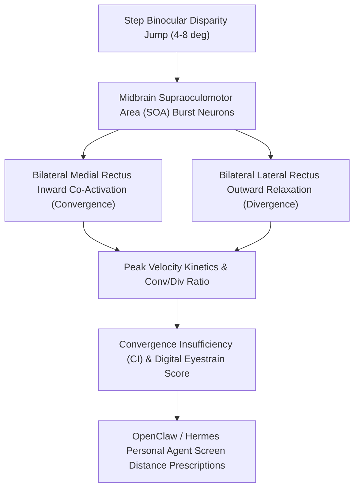

# Oculomotor Binocular Vergence Dynamics Skill

[](LICENSE)
[](https://www.python.org/)
[](requirements.txt)
[](mcp_server.py)
[](SKILL.md)

Zero-dependency sovereign personal agent skill for non-invasive evaluation of Binocular Vergence Dynamics peak convergence/divergence velocity, latency, and convergence insufficiency asthenopia.



## Features
- **Deterministic Math**: Pure Python standard library implementation with zero external dependencies.
- **Oculomotor Neurophysiology Standards**: Implements validated equations for step vergence velocities, main sequence ratios, and settling time constants.
- **Digital Eyestrain & Convergence Fatigue Shield**: Sensitive detection of binocular motor fusion breakdown during intense screen reading.
- **Model Context Protocol (MCP)**: Native JSON-RPC tool integration for LLMs and autonomous agents.

## Quickstart

```python
from client import OculomotorVergenceDynamicsClient

client = OculomotorVergenceDynamicsClient()
result = client.evaluate_vergence_dynamics(
    step_disparity_deg=6.0,
    peak_convergence_velocity_deg_s=29.5,
    peak_divergence_velocity_deg_s=18.2
)
print("Conv/Div Ratio:", result["convergence_divergence_ratio"])
print("Vergence Score:", result["vergence_health_score"])
print("Classification:", result["classification"])
```

## License
Apache-2.0
